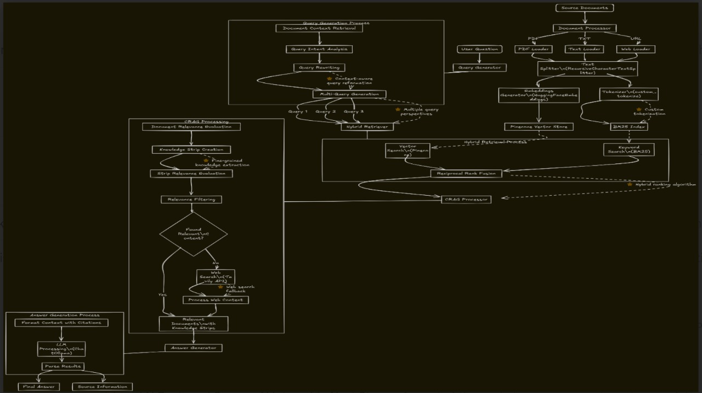

# 🤖 Synergistic RAG System

### 🧠 Advanced Retrieval-Augmented Generation with Contextual Intelligence

```{=html}
<p align="center">
```
`<strong>`{=html}🔎 Hybrid Retrieval · 🧩 Contextual Evaluation · 🔄
Self-Correction · 💬 Grounded Generation`</strong>`{=html}
```{=html}
</p>
```
```{=html}
<p align="center">
```
``{=html}
``{=html}
``{=html}
``{=html}
``{=html}
```{=html}
</p>
```

------------------------------------------------------------------------

## 🌟 Overview

**Synergistic RAG System** is an intelligent Retrieval-Augmented
Generation application designed to improve how information is retrieved,
evaluated, and used to generate answers.

Unlike a basic RAG workflow that relies only on similarity search, this
project combines **multi-query processing, hybrid retrieval, contextual
relevance evaluation, knowledge-strip extraction, and web-search
fallback**. The goal is to provide responses that are more relevant,
transparent, and grounded in retrieved information.

The application brings these capabilities together in an interactive
**Streamlit** interface, where users can load knowledge sources, ask
questions, and inspect retrieved context and source information.

## 🧠 System Architecture & Algorithm Flow



The system follows a multi-stage pipeline:

### 1. 📝 Query Processing & Enhancement

-   🔀 **Multi-Query Generation:** Generates query variations to improve
    retrieval coverage.
-   🎯 **Query Intent Analysis:** Identifies the user's information need
    and relevant search terms.
-   ✍️ **Query Rewriting:** Refines queries using available document
    context.

### 2. 🔎 Hybrid Retrieval Engine

-   🧠 **Vector Search (Pinecone):** Performs semantic retrieval using
    `BAAI/bge-m3` embeddings (1024 dimensions).
-   🔤 **Keyword Search (BM25):** Finds exact terms and terminology
    through lexical matching.
-   ⚖️ **Reciprocal Rank Fusion (RRF):** Combines rankings from vector
    and keyword retrieval.

### 3. 🧩 Contextual RAG (CRAG) Processing

-   📊 **Document Relevance Evaluation:** Uses an LLM to assess how
    relevant retrieved documents are to the query.
-   🧱 **Knowledge-Strip Extraction:** Breaks documents into meaningful,
    self-contained knowledge units.
-   🎯 **Strip Relevance Scoring:** Evaluates individual knowledge
    strips for query relevance.
-   🌐 **Web-Search Fallback:** Uses Tavily search when the local
    knowledge base does not provide sufficient information.

### 4. 💬 Intelligent Response Generation

-   🧵 **Context Assembly:** Combines relevant knowledge strips into a
    coherent context.
-   🔖 **Source Citation:** Preserves source references to support
    traceability.
-   ✨ **Response Synthesis:** Generates an answer using the selected
    contextual information.

## ✨ Key Features

### 🔍 Advanced Retrieval

-   🔀 Hybrid semantic and keyword search.
-   🧠 Multi-query expansion for broader retrieval coverage.
-   ⚖️ Reciprocal Rank Fusion to combine retrieval results.

### 🧩 Contextual Intelligence

-   📊 LLM-based document relevance evaluation.
-   🧱 Extraction of focused, self-contained knowledge strips.
-   🎯 Relevance scoring and filtering before answer generation.
-   🔄 Adaptive processing based on retrieved content quality.

### 🌐 Multi-Source Knowledge

-   📄 Supports PDF, CSV, and TXT documents, as well as web pages.
-   🔎 Tavily-powered web search for knowledge augmentation.
-   🔖 Source references, relevance scores, and content previews.

### 💻 Interactive Streamlit Experience

-   💬 Conversational chat interface.
-   📚 Document loading and management through the sidebar.
-   🔍 Visibility into retrieved sources and relevance scores.
-   ⏱️ Processing-step and system-status visibility.

### 🛠️ Reliability & Optimization

-   🪵 Structured logging with Loguru.
-   🧯 Error handling and user-facing feedback.
-   ⚡ In-memory LLM caching to reduce redundant calls.
-   🧹 Resource cleanup and memory-conscious processing.

## 🏗️ Technical Architecture

``` text
┌───────────────────────────────────────────────────────────────┐
│                    🤖 Synergistic RAG System                  │
├───────────────────────────────────────────────────────────────┤
│  💻 Frontend — Streamlit                                      │
│  ├── 💬 Chat Interface                                        │
│  ├── 📚 Document Management                                   │
│  └── 🔎 Source Visualization                                  │
├───────────────────────────────────────────────────────────────┤
│  🧠 Core RAG Engine — core/vector.py                           │
│  ├── 📝 Query Processing                                      │
│  │   ├── Multi-Query Generation                               │
│  │   ├── Intent Analysis                                      │
│  │   └── Query Rewriting                                      │
│  ├── 🔍 Hybrid Retrieval                                      │
│  │   ├── Vector Search — Pinecone + BGE-M3                    │
│  │   ├── Keyword Search — BM25                                │
│  │   └── Reciprocal Rank Fusion                               │
│  ├── 🧩 CRAG Processing                                       │
│  │   ├── Document Relevance Evaluation                       │
│  │   ├── Knowledge-Strip Extraction                           │
│  │   └── Web Search Integration                               │
│  └── 💬 Response Generation                                   │
│      ├── Context Assembly                                     │
│      ├── Source Citation                                      │
│      └── Answer Synthesis                                     │
├───────────────────────────────────────────────────────────────┤
│  🔌 External Services                                         │
│  ├── Pinecone — Vector Database                               │
│  ├── Ollama — qwen2.5-coder:1.5b                              │
│  └── Tavily — Web Search API                                  │
└───────────────────────────────────────────────────────────────┘
```

## 🧰 Technology Stack

  Area                       Technology
  -------------------------- ---------------------------------
  🐍 Language                Python 3.11+
  💻 User interface          Streamlit
  🧠 Embedding model         `BAAI/bge-m3` (1024 dimensions)
  🗄️ Vector database         Pinecone
  🔤 Lexical retrieval       BM25
  ⚖️ Ranking fusion          Reciprocal Rank Fusion (RRF)
  🤖 Local LLM runtime       Ollama
  🧠 Configured LLM          `qwen2.5-coder:1.5b`
  🌐 Web search              Tavily
  🪵 Logging                 Loguru
  📦 Dependency management   pip / uv

## 🚀 Quick Start

### 📋 Prerequisites

Before running the application, make sure you have:

-   🐍 Python 3.11 or later.
-   🔑 A Pinecone API key.
-   🦙 Ollama installed and running locally.
-   🌐 A Tavily API key (optional; used for web-search fallback).
-   📦 Git installed.

### 1️⃣ Clone the Repository

``` bash
git clone https://github.com/pushpakrai/Self-correcting-rag.git
cd Self-correcting-rag
```

### 2️⃣ Create and Activate a Virtual Environment

**Windows (PowerShell):**

``` powershell
python -m venv .venv
.venv\Scripts\Activate.ps1
```

**Linux / macOS:**

``` bash
python3 -m venv .venv
source .venv/bin/activate
```

### 3️⃣ Install Dependencies

**Using pip:**

``` bash
python -m pip install --upgrade pip
pip install -r requirements.txt
```

**Using uv:**

``` bash
uv pip install -r requirements.txt
```

### 4️⃣ Configure Environment Variables

Create a `.env` file in the project root and add your credentials:

``` env
PINECONE_API_KEY=your-pinecone-api-key
TAVILY_API_KEY=your-tavily-api-key
```

> 🔐 **Security:** Keep your real API keys private. Do not commit `.env`
> to GitHub. Add `.env` to `.gitignore`.

`TAVILY_API_KEY` is optional if you do not plan to use web-search
fallback.

### 5️⃣ Start Ollama and Download the Model

In a terminal, start the Ollama service:

``` bash
ollama serve
```

In another terminal, download the configured model:

``` bash
ollama pull qwen2.5-coder:1.5b
```

### 6️⃣ Launch the Application

From the project root, run:

``` bash
streamlit run core/orchastrator.py
```

🌐 Streamlit will display a local URL in the terminal. Open that URL in
your browser to use the application.

## 📖 Usage Guide

### 📥 Load Documents

1.  Open the application and locate the sidebar.
2.  Enter document sources, such as supported file paths or URLs.
3.  Select **Load Documents** to process and index the content.
4.  Follow the status indicators while loading completes.

### 💬 Ask Questions

1.  Enter a question in the chat interface.
2.  Follow the visible processing steps.
3.  Expand the source sections to inspect citations and retrieved
    content.
4.  Review retrieved context and relevance information in the sidebar.

### ⚙️ Manage the Knowledge Base

-   🧹 **Clear All Data:** Clears indexed documents and chat history
    through the application controls.
-   📊 **System Status:** Review loaded documents and processing
    information.
-   🔎 **Source Transparency:** Inspect retrieved documents, previews,
    and relevance scores.

## 🔧 Configuration

The following values are documented in the project configuration.

### 🧠 Model Settings

``` python
# Embedding model
EMBEDDING_MODEL = "BAAI/bge-m3"  # 1024-dimensional embeddings

# Local Ollama model
LLM_MODEL = "qwen2.5-coder:1.5b"

# Temperature settings
JSON_LLM_TEMPERATURE = 0.0
GENERAL_LLM_TEMPERATURE = 0.1
```

### 🔎 Retrieval & CRAG Parameters

``` python
# Hybrid retrieval
PINECONE_RETRIEVAL_K = 10
BM25_RETRIEVAL_K = 10
HYBRID_FINAL_K = 3

# CRAG processing
CRAG_INITIAL_DOC_LIMIT = 3
CRAG_WEB_DOC_LIMIT = 2
RELEVANCE_THRESHOLD = 0.3
```

> 📝 These are the documented default values. Update the relevant
> configuration in the code if you want to tune retrieval behavior.

## 📁 Project Structure

``` text
Self-correcting-rag/
├── 📂 core/
│   ├── vector.py             # Core RAG and retrieval implementation
│   ├── orchastrator.py       # Streamlit interface and orchestration
│   └── config.py             # Application configuration
├── 📂 public/
│   └── algoflow.jpg          # Algorithm flowchart
├── 📂 logs/                  # Application logs (auto-created)
├── 📄 requirements.txt       # Python dependencies
├── 📄 pyproject.toml         # uv / Python project configuration
├── 📄 .python-version        # Python version setting
├── 📄 .gitignore             # Files excluded from Git
└── 📄 README.md              # Project documentation
```

## 🧪 Algorithm Details

### 📝 Query Enhancement Pipeline

1.  📄 **Document Summary Generation:** Creates context-aware summaries
    to support query optimization.
2.  🎯 **Intent Analysis:** Extracts relevant terms and identifies the
    information need.
3.  ✍️ **Query Rewriting:** Refines the query using document context and
    intent.
4.  🔀 **Multi-Query Expansion:** Generates complementary query
    variations to improve coverage.

### ⚖️ Hybrid Retrieval Strategy

-   🧠 **Vector Search:** Captures semantic similarity and conceptual
    relationships.
-   🔤 **BM25 Search:** Supports exact-term matching and specific
    terminology.
-   ⚖️ **RRF Fusion:** Combines ranked results using reciprocal-rank
    scores.

### 🧩 CRAG Intelligence

-   📊 **Relevance Evaluation:** Assesses document-query alignment.
-   🧱 **Knowledge-Strip Extraction:** Splits content into focused,
    self-contained units.
-   🛡️ **Quality Control:** Filters irrelevant or low-quality context
    before generation.
-   🌐 **Web-Search Fallback:** Expands the available information when
    local retrieval is insufficient.

## 🛠️ Advanced Engineering Features

### 🪵 Logging & Monitoring

-   Structured application logging with Loguru.
-   Query-processing and retrieval statistics.
-   Detailed error context to support debugging.

### ⚡ Caching & Optimization

-   In-memory LLM caching to reduce repeated calls.
-   Processing flow designed for stability.
-   Resource cleanup and memory optimization.

### 🧩 Extensibility

-   Modular separation of application responsibilities.
-   Extensible document-loading and retrieval components.
-   Configuration-driven behavior for easier customization.

## 🤝 Contributing

Contributions, suggestions, and improvements are welcome! 🎉

1.  🍴 Fork the repository.
2.  🌿 Create a feature branch: `git checkout -b feat/your-feature`.
3.  💻 Make and test your changes.
4.  📌 Commit with a clear message.
5.  🚀 Push your branch and open a Pull Request.

Please include relevant tests and update documentation when changing
application behavior.

## 📄 License

This project states an MIT License. See the repository's `LICENSE` file
for the license text. If the `LICENSE` file is not yet present, add it
before presenting the repository as formally licensed under MIT.

## 🙏 Acknowledgments

Thanks to the tools and projects that support this implementation:

-   🦜 **LangChain** --- RAG framework and integrations.
-   🗄️ **Pinecone** --- Vector database capabilities.
-   🦙 **Ollama** --- Local LLM inference.
-   🎈 **Streamlit** --- Interactive application interface.
-   🤗 **Hugging Face** --- BGE-M3 embedding model.

------------------------------------------------------------------------

## 👨‍💻 Author

**Pushpak Rai**

-   🐙 GitHub: [@pushpakrai](https://github.com/pushpakrai)
-   💼 LinkedIn: [Pushpak
    Rai](https://www.linkedin.com/in/pushpak-rai-0ab3a3200/)

```{=html}
<p align="center">
```
`<strong>`{=html}💡 Building smarter knowledge systems through
retrieval, contextual intelligence, and self-correction.
🚀`</strong>`{=html}
```{=html}
</p>
```
